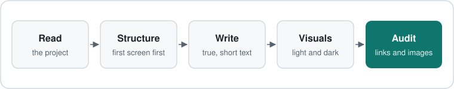

# skills

Skills for coding agents: plain Markdown instructions plus small scripts, in the open Agent Skills format (a folder with a `SKILL.md`). Nothing in them is tied to one agent: they need only file access, a shell and `python3`. Tested in Claude Code so far.

<p>
  <a href="LICENSE"></a>
  
  
</p>

| Skill | What it does |
| --- | --- |
| [`beauty-readme`](beauty-readme) | Writes or redesigns a README so a first-time visitor understands the project in ten seconds and can try it in one minute, on GitHub and GitLab, in light and dark mode |

## Install

Clone the repository once, then link the skill into the folder your agent reads skills from:

```sh
git clone https://github.com/alambari/skills ~/skills-alambari
mkdir -p ~/.agents/skills ~/.claude/skills
ln -s ~/skills-alambari/beauty-readme ~/.agents/skills/beauty-readme   # agents that read ~/.agents/skills
ln -s ~/.agents/skills/beauty-readme ~/.claude/skills/beauty-readme    # Claude Code
```

Any other agent: point it at the `beauty-readme` folder, or copy that folder into its skills directory. The folder is self-contained.

Then ask for it in plain words: "make this README beautiful", "audit the README", "add a logo and a diagram to the README".

## beauty-readme

<p align="center">
  
</p>

The pages people admire are restrained: a mark, one sentence, a few badges, a real screenshot, a table of real numbers. Nearly all of their effect is structure and true content, so the skill works in that order.

- **Reads the project first.** Name, install path, commands and numbers come from the manifest, the scripts and the test results, not from the old README.
- **Fixes the first screen.** A mark, one sentence that says what it is and for whom, three to five links, at most five badges, one visual that proves the claim.
- **Never invents.** No made-up stars, users, benchmarks or badges for services the repository does not use. A project without numbers gets no numbers section.
- **Light and dark, GitHub and GitLab.** GitHub switches two image files with `<picture>`. GitLab does not document a theme switch, so there the skill uses one image that paints its own background. The differences between the hosts are in [`references/hosts.md`](beauty-readme/references/hosts.md), taken from GitLab's own documentation.
- **Checks its own work.** A script audits the result before the agent hands it over.

### The audit script

Standard library only, Python 3.8 or later. It reads files and never changes them or uses the network.

```sh
python3 beauty-readme/scripts/audit_readme.py README.md --host github   # or gitlab, or both (the default)
```

On a deliberately broken README it prints, among others:

```text
ERROR: link points at #nope, and no heading has that anchor
ERROR: image points at assets/missing.png, which does not exist
ERROR: image without alt text: assets/logo-light.svg
ERROR: assets/logo-light.svg: <script> is removed or blocked by the host
ERROR: assets/logo-light.svg has no dark partner (logo-dark.svg)
ERROR: placeholder text left in the README: "TODO" (near line 5 of the prose)
WARNING: the {width=...} image attribute is GitLab syntax and shows as plain text on GitHub; use 
WARNING: "blazingly" is a claim without content; say what it does instead
```

It exits with 1 when it finds an error (or a warning, with `--strict`), so it can run in CI.

### What is in the folder

```text
beauty-readme/
├── SKILL.md                 the eight steps, in order
├── references/
│   ├── structure.md         the first screen, section order per project type, wording
│   ├── visuals.md           light and dark, colours, SVG rules, mark, hero, badges, diagrams
│   └── hosts.md             what GitHub and GitLab each render, and the portable choice
├── templates/               first screen, wordmarks, flow diagrams (light, dark and portable)
└── scripts/
    └── audit_readme.py      links, anchors, images, SVG safety, host-only syntax, placeholders
```

### Made with it

- The README of [alambari/crew](https://github.com/alambari/crew): mark, flow diagram in light and dark, and a table of measured results.
- This page.

## Limits

- The skill gives an agent a method and a checker; the result still depends on the agent and on what the repository really contains. It cannot take your screenshots.
- GitLab behaviour is described from GitLab's documentation. Where that documentation is silent (centring with `align`, theme switching for images), the skill says so and uses the portable form; check the result in GitLab's own preview.
- The audit checks local files only. It does not fetch remote links or badge images.

## License

[MIT](LICENSE)
